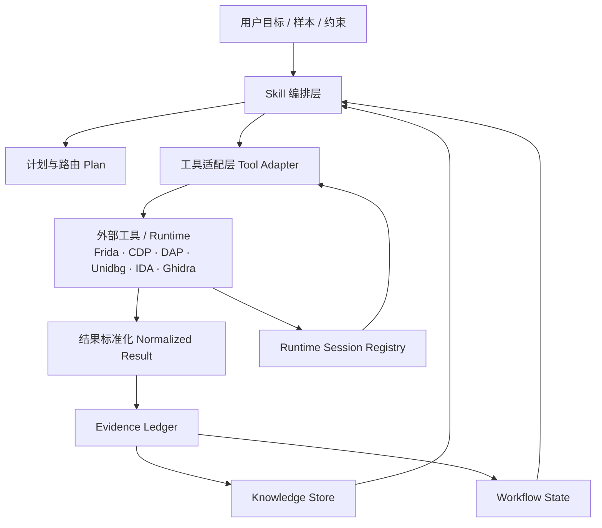
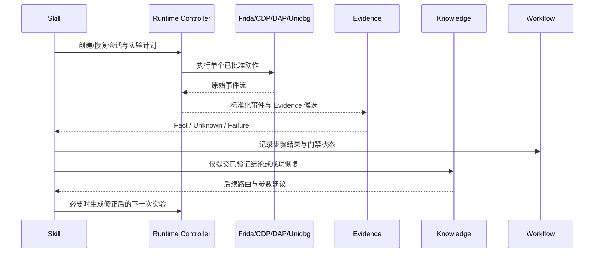

# reverse 逆向 Agent 总体架构

## 目标

reverse 的核心交付物是**可编排的逆向 Skill 系统**，不是工具数量集合。Skill 负责判断、路由、解释和推进；工具负责一次受控执行；领域状态负责保存可复现事实、运行时会话、知识和工作流。

测试采用分层契约验证和少量端到端冒烟。新增 Skill 或工具不再默认要求一套独立测试；只有改变共享契约、持久化、审批边界或关键用户路径时才增加回归覆盖。

## 总体分层



### 1. Skill 编排层

Skill 是模型可读的逆向方法论和决策约束，位于 `.agents/skills/` 或内置 Skill 资源中。它描述：

- 目标识别和 G0-G4 阶段
- 平台/格式路由
- 工具优先级、降级链和缺依赖处理
- 静态、动态、证据和复核的推进条件
- 何时暂停并要求用户批准
- 结果如何写入 Evidence、Knowledge 和 Workflow
- 如何控制上下文预算和输出粒度

Skill 不直接维护持久化状态，不实现解析器，不拼接任意 shell 命令，不把工具输出当作已验证结论。

推荐 Skill 族：

| Skill | 职责 |
|---|---|
| `reverse-lab` | 总体编排、阶段推进、失败恢复、证据纪律 |
| `native-binary-reverse` | PE/ELF/Mach-O、反调试、符号和 native 调试 |
| `android-reverse` | APK/AAB/DEX、脱壳、Frida、Unidbg、JNI/native 链路 |
| `web-protocol-reverse` | 浏览器/CDP、JS、网络、Crypto、WebSocket、GraphQL |
| `reverse-tool-guide` | 工具能力、依赖、安装、降级和调用示例 |
| `reverse-knowledge` | 检索、验证、沉淀和过期治理 |
| `vmp-reverse` | VMProtect 脱壳转储、IAT 修复、函数提升、符号化 Trace 与差分验证 |

### 2. 工具适配层

工具执行单个明确动作，不负责完整调查流程。每个工具必须声明：

```ts
interface ToolCapability {
  name: string;
  domain: "inspect" | "runtime" | "evidence" | "workflow" | "knowledge";
  approval: "read" | "write" | "exec";
  inputs: InputSchema;
  outputs: ResultSchema;
  dependencies: DependencySpec[];
  bounded: { maxBytes?: number; maxEvents?: number; timeoutMs?: number };
  artifacts: ArtifactPolicy;
}
```

工具结果统一为：

```ts
interface NormalizedToolResult<T> {
  ok: boolean;
  data?: T;
  facts?: FactCandidate[];
  artifacts?: ArtifactRef[];
  warnings?: string[];
  missingDependencies?: DependencyStatus[];
  error?: { category: string; message: string; retryable: boolean };
  locator?: string;
}
```

工具可以是纯解析器、外部 CLI 包装器、MCP 服务客户端或有生命周期的 Runtime Controller。它们都必须限制输入、输出、超时、事件数量和敏感信息。

### 3. 领域状态层

领域状态是被动、可持久化、可审计的事实源：

- **Workspace**：目标、项目根目录、样本摘要、产物和报告索引。
- **Evidence Ledger**：Fact、Hypothesis、Unknown、Conclusion；保存来源、定位、哈希、时间和验证关系。
- **Runtime Session**：Frida、Browser/CDP、DAP、Unidbg 等会话状态、心跳、恢复计划和事件缓冲。
- **Workflow State**：目标格式、步骤、门禁、状态、失败分类、重试和恢复计划。
- **Knowledge Store**：仅从验证后的结论或成功恢复路径沉淀可复用模式。

状态层不替代 Skill 决策；它提供可查询的状态和审计轨迹。

## 统一动态闭环



统一事件：

```ts
interface UniversalDynamicEvent {
  id: string;
  source: "frida" | "browser" | "dap" | "unidbg" | "custom";
  sessionId: string;
  seq: number;
  timestamp: string;
  kind: "message" | "stdout" | "stderr" | "trace" | "breakpoint" | "memory" | "network" | "crypto" | "lifecycle" | "error" | "custom";
  channel?: string;
  target?: string;
  payload?: unknown;
  raw?: string;
  metadata?: Record<string, unknown>;
}
```

事件只能先成为 Fact candidate；Hypothesis 验证成功后才能成为 Conclusion；Conclusion 才能触发 Knowledge promotion 和 Workflow advancement。

## Skill、工具和状态的边界

| 问题 | Skill | Tool | Domain state |
|---|---:|---:|---:|
| 目标属于 APK 还是 ELF | 决策和解释 | 提供识别结果 | 保存事实 |
| 选择 JADX、Frida 还是 Unidbg | 路由 | 声明能力和依赖 | 保存工作流计划 |
| 解析 ELF/DEX/APK | 不实现 | 执行解析 | 保存 Fact |
| 注入、断点、模拟执行 | 决策和审批请求 | 执行单步动作 | 保存 Session/Event |
| 失败后是否重试 | 归因和策略 | 返回可分类错误 | 保存 Recovery |
| 是否可沉淀知识 | 判断验证条件 | 提供证据引用 | 执行持久化 |

## Android 目标链

```text
APK/AAB
  -> package inspection
  -> DEX/Manifest/ABI/native .so inventory
  -> static route: JADX / Apktool / DEX / ELF
  -> dynamic route: ADB + Frida
  -> native route: verified JNI exports; runtime RegisterNatives mapping when observed
  -> emulation route: Unidbg ARM32/ARM64 + JNI call
  -> dump/decrypt/repair
  -> Evidence verification
  -> reusable Knowledge pattern
```

Unidbg 是 Runtime Controller，不是 Skill。Skill 只决定何时使用、需要哪些参数和验证标准。无法满足模拟环境时返回缺失依赖或环境缺口，不伪造调用结果。

静态 JNI 检查仅将已定义、可见的 ELF 函数导出与 DEX native 声明匹配；`JNI_OnLoad`、`RegisterNatives` 和原始字符串仅提供调查线索。动态注册尚未观测时，方法保持 `unresolved`，不归属到候选 SO。

### 样本修改与产物验证

`dex_patch` 与 `apk_artifact` 将 apk-reverse 的 MIT 工具机制适配为正式内置工具，Python 源码作为文本资产嵌入安装包和独立二进制，运行时经现有 Python 发现机制启动。原始样本保持只读，写入使用明确的新路径、私有暂存与独占发布。

- `dex_patch`：按类、方法、描述符和语义条件定位指令；默认预演等长补丁，校验指令边界、分支/payload、move-result 邻接，按 SHA-1 → Adler-32 顺序更新头部。它执行有限结构校验，ART 类型校验和实际行为验证仍在设备环节完成。
- `apk_artifact`：按条目哈希与布局差分，支持 `dex_files` 与任意条目替换 `replace_files`（二者重叠定义将被严格拒绝），保留嵌套 `META-INF` 运行时资源，处理资源 4 字节和 native 库 16KiB 包内对齐；调用 zipalign 后签名，再执行 apksigner 验证。从干净原始基准或早先衍生版本重打包时，必须保留所有已验证的累积基准补丁（确定性 A + B 重放），或附带强制原因显式退役补丁（`retire_patch`）。产物在目标文件系统执行私有暂存并原子独占发布（`link` 或 `COPYFILE_EXCL`）；若后续工作流衍生版本登记失败，将自动执行回滚删除以保护谱系所有权。现有密钥库和环境变量/受保护文件凭证由调用方提供。
- 能力解析区分离线 Python、完整签名依赖和设备主机依赖；静态目录检查保持设备连接状态未验证。依赖统一经过现有 CLI/TUI 工具安装目录。
- 设备校验明确指定 serial，比较已安装 APK 与本地产物 SHA-256，采集启动状态、进程日志和截图；目标功能验证单独记录。产物哈希和补丁坐标接入现有 `reverse_workflow` 构建谱系与证据体系。

使用契约见 [dex_patch](tools/dex_patch.md) 与 [apk_artifact](tools/apk_artifact.md)。上游快照为 `bd6dd0c59ce1f9af75f1293ef9518fb6f5d28c6c`，版权及 MIT 许可保留在 `THIRD-PARTY-NOTICES.txt`；实验性内核与硬件模板未纳入稳定工具。

## Browser 目标链

```text
Tab/CDP
  -> page/script/source map inventory
  -> hook preset selection
  -> network/WS/crypto/console capture
  -> Debugger breakpoint/stack/scope
  -> request or function replay
  -> structured event normalization
  -> Evidence correlation: script ↔ hook ↔ request ↔ result
  -> Knowledge/Workflow update
```

Browser Controller 负责 Tab、CDP 和事件生命周期；Browser Skill 负责逆向策略和风险判断。

## 基础工具 vs 可选工具策略与能力闭环 (Base vs Optional Tool Policy)

### 1. 工具分层策略

reverse 坚持**Skill 为先、工具按需接入**的架构，反对盲目泛化堆砌外部工具：

- **基础工具 (Native Base Tools)**：内置于 reverse 运行时的零依赖只读检验器与操作系统通用工具（如 `android_package_inspect`, `websocket_observe`, `windows_observe`, `pcap_inspect`, `sqlite_inspect`, `firmware_inspect`, `crashdump_inspect`, `binary_metadata_inspect`, `evm_inspect`, `binary_diff`, `sourcemap_inspect`, `strings`, `file` 等）。这些工具提供基础静态分类、结构解析与证据提取。内置适配器 `r2_inspect` 和 `ghidra_inspect` 分别需要通过 setup 按需安装 radare2 和 Ghidra；依赖未就绪时返回结构化缺失状态。原生 MCP 会话工具 `native_mcp_session` 管理 x64dbg、Ghidra 与 radare2 的上游工具动态挂载、安全断开与动态到静态（VA-to-static）地址映射。
- **可选外部工具 (Optional Tools)**：特定深层逆向分析所需的高级 CLI 工具与 MCP 辅助服务（如 `apktool`, `jadx`, `unidbg`, `radare2`, `frida`, `mitmproxy`, `tshark`, `hbctool`, `playwright-mcp`, `r2mcp`, `x64dbg-mcp`, `ghidra-mcp` 等）。它们在受信目录（`SKILL_TOOL_CATALOG` / `MCP_SERVICE_CATALOG`）中注册，**绝不要求在全新安装时一次性全部安装，也绝不允许静默自动安装**。

### 2. 场景能力模型 (Capability-Oriented Discovery)

Agent 面向分析**场景与能力**（Capability），而非单纯记忆零散工具名。系统在 `packages/coding-agent/src/extensibility/skill-tool-catalog.ts` 中维护规范能力描述器（`CapabilityDescriptor`）与实时解析器（`resolveReverseCapabilities`）：

| 能力标识 (`id`) | 场景说明 | 推荐原生工具 | 可选外部工具 | 降级链 (Fallbacks) | 受信安装命令 | 安装后即时调度 |
|---|---|---|---|---|---|---|
| `android_native_emulation` | ARM32/ARM64 Android .so 原生库无设备模拟执行与 JNI 调用 | `android_package_inspect` | `unidbg` | `frida`, `readelf`, `radare2` | `reverse setup reverse unidbg` | 执行 `reverse unidbg build / scaffold / launch` 自动化生成脚手架并动态挂载 SSE MCP 调试工具 |
| `apk_unpacking` | APK/AAB 资源解码、Manifest 解析与 Dalvik 字节码反编译 | `android_package_inspect` | `apktool`, `jadx`, `baksmali`, `dexdump` | `file`, `strings` | `reverse setup reverse apktool` | 执行 `apktool d -f -o <dir> <apk>` 或 `jadx -d <dir> <apk>` |
| `dex_patching` | DEX 指令检查、有限结构验证、等长语义补丁 | `dex_patch` | `python`, `jadx`, `baksmali`, `dexdump` | 只读检查与完整 smali 重建分流 | `reverse setup reverse python` | 默认预演，确认后写入独立 DEX |
| `apk_artifact_generation` | APK 差分、重打包、对齐、签名及设备校验 | `apk_artifact` | `python`, `zipalign`, `apksigner`, `java`, `adb` | 离线未签名产物与设备运行验证分开 | `reverse setup reverse apksigner` | 解析缺失依赖后执行所需动作，签名后验证 |
| `browser_debugger` | 网页应用 DOM 调试、JS 动态断点、执行流分析与 CDP 自动化 | `browser_reverse_session` | `playwright-mcp` | `mitmproxy`, `curl`, `file` | `reverse setup reverse playwright-mcp` | 配置 .reverse/mcp.json playwright 服务或建立 CDP 调试会话 |
| `websocket_capture` | WebSocket 全双工数据帧实时截获、协议解包与序列分析 | `websocket_observe` | `mitmproxy`, `tshark` | `pcap_inspect`, `strings`, `curl` | `reverse setup reverse mitmproxy` | 启动 `mitmweb --web-port 8081` 或 `tshark -Y websocket` |
| `native_debugger` | Native (ELF/PE/Mach-O) 二进制动态调试、内存与寄存器单步追踪 | 已发现且启用的 native DAP 后端使用 `debug`；否则 `triage` 保留静态入口 | native DAP 适配器、`radare2`；`frida` 插桩与 `ghidra` 静态分析作降级 | `binary_metadata_inspect`, `readelf`, `strings`, `file` | `reverse setup reverse radare2` | 按实际后端启动 DAP 或 `r2 -d <binary>`；仅有 Frida 时保持部分可用 |
| `js_deobfuscation` | Minified/Packed JS 语法树解构、SourceMap 还原与 Hermes 字节码反汇编 | `sourcemap_inspect` | `hbctool` | `strings`, `file` | `reverse setup reverse hbctool` | 执行 `hbctool disasm <bundle> <out>` 或脚本解混淆 |
| `traffic_interception` | HTTP/HTTPS 与网络协议透明代理、解密与重放 | `pcap_inspect` | `mitmproxy`, `tshark` | `curl`, `strings` | `reverse setup reverse mitmproxy` | 启动 `mitmproxy -p 8080` 代理捕获 |

`native_debugger.ready` 表示主机已发现 native DAP 适配器且会话启用 `debug`，或已安装 radare2。Frida、Ghidra 以及仅配置但未连接的 MCP 服务不单独满足原生单步调试要求。工具发现保持只读；目标架构、设备连接、权限和实际断点结果在执行阶段验证。

### 2.1 Unidbg 模拟执行与参数编码契约 (Unidbg Emulation Contract)

`unidbg` 针对 Android JNI 和 iOS IPA 原生二进制提供端到端无机模拟执行，自动接入上游 MCP 调试器 (`http://127.0.0.1:<port>/sse`)：
- **字节数组 (`bytes` / `byte[]`)**：支持普通文本（按 UTF-8 编码为字节数组）、`0x` 前缀十六进制串（如 `0x1234abcd`）或 `b64:` / `base64:` 前缀 Base64 编码数据。
- **整数与长整型 (`int` / `long`)**：支持十进制数值字符串（如 `"32"`, `"1000"`）或 `0x` 前缀十六进制（如 `"0x20"`）。
- **字符串 (`string`)**：支持普通字符串，对于包含空格的文本支持 `b64:` 前缀 Base64 字符串（规避调试器控制台的分词截断）。
- **原生符号调用与 Hex 语义**：上游 `call_symbol` 原生参数默认按 16 进制解析地址与数值（如 `0x20` 即十进制 32）；自定义生成的 `McpTool` 则对命名参数提供类型化解析与真实返回值回显。
- **安全隔离与本地回环绑定**：生成的 Harness 在 JVM 启动时安装 `SecurityManager.checkAccept` 校验，在 Socket Accept 层拦截所有非回环网卡（LAN/公网）TCP 连接，保证调试服务仅受控响应 `127.0.0.1`。

### 2.2 原生 MCP 会话契约与动态验证体系 (Native MCP Session & Verification Architecture)

为支持对原生二进制（PE/ELF/Mach-O）的高级交互式分析，reverse 通过 `native_mcp_session` 统一纳管 x64dbg、Ghidra 与 radare2 的原生 MCP 会话生命周期与地址映射，并与 Frida 动态插桩形成互补链条：

1. **安装与面板标识 (Setup Catalog & Panel IDs)**：
   - 依赖项通过受信目录受控安装，对应 CLI/TUI 设置面板标识为 `x64dbg-mcp`、`ghidra-mcp` 与 `r2mcp`（例如 `reverse setup reverse x64dbg-mcp`）。
   - TUI `/setup` 逆向工具面板与 CLI 子命令具备相同 ID 与交互式安装能力，未安装前不静默自动下载。

2. **会话生命周期与动态工具发现 (Session Lifecycle & Dynamic Discovery)**：
   - 工具提供 `connect`、`status`、`list`、`disconnect` 与 `locate` 动作，严格基于活动会话的 MCPManager 实现进程隔离与所有权管理。
   - 上游 MCP 服务端（如 x64dbg_automate、GhidraMCP、r2mcp）暴露的原生工具在连接成功后**动态发现并挂载**到当前会话命名空间中，系统与 Prompt 不硬编码易变的长工具列表。
   - `disconnect` 遵循友好的分离机制（如调用 x64dbg `disconnect`），解除 MCP 挂载与工程锁，绝不误杀宿主调试器或目标被调试进程。

3. **后端连接模式与环境约束**：
   - **Ghidra**：支持无头持久化模式（传入 `target`，维护 `/tmp` 之外的持久工程目录 `project_dir` 并启用 `--save` 跨轮次复用分析结果，每个工程目录仅允许单 Java 进程持有互斥锁）与 GUI 模式（省略 `target`，连接 `backend_url`，默认 `http://127.0.0.1:8080/`）。
   - **radare2 与 r2_inspect 契约**：内置 `r2_inspect` 工具严格限定参数为规范选择器（`symbol`、`address`、`target`），任何未知参数别名（如 `function`）均被直接拒绝并返回结构化错误；在结果中忠实回显实际解析的目标（`details.reference` 与 `details.target`），未指定选择器而回退到入口点时显式标记 `referenceDefaulted: true`。会话模式通过 r2mcp (`r2pm -r r2mcp`) 建立持久分析会话，调用 `open_file` 打开目标二进制并通过 `show_info` 校验，在多轮对话中保持分析状态，避免单次命令行频繁重开与重搜。
   - **IDA 四层后端独立区分**：严格独立判定 IDA 的四类不同后端形态，绝不混淆：1) IDA GUI 桌面应用程序；2) `idalib` 无头 SDK 运行时（`read` 虚拟文件读取与 `ida` 工具后台工作必需）；3) 本地数据库文件（`.idb` / `.i64` 原生解析）；4) 可选 MCP 桥接（`ida-mcp`）。未配置或断开的 MCP 桥接并不代表 IDA 整体安装缺失（bridge absent != whole IDA absent），存在本地 GUI 或 `idalib` 时仍提供对应层级的降级与分析能力。
   - **IDA 原生 Python 适配器**：原生库存在与适配器就绪独立报告；原生工具、能力状态及设置面板按相同解释器优先级和工作环境，限时依次导入 `idapro`、`ida_domain`。缺包时 CLI `reverse setup reverse ida --execute` 与 TUI `/setup reverse ida` 提供实际解释器的固定版本修复命令，确认安装后重新验证；Python 版本、解释器启动及导入／授权失败保留各自诊断。数据库打开、反编译结果继续在执行阶段验收。
   - **x64dbg**：支持本地启动（`target`）、附加已有实例（`session_pid`）与跨平台远程连接（`host` + `req_rep_port` + `pub_sub_port`）。注意：绝对 Windows 目标路径在参数与配置中必须保持 Windows 宿主路径格式（如 `C:\targets\app.exe`）；ZeroMQ RPC 协议**无内置认证机制**，远程调试必须经由私有受信网络或 SSH 隧道（如端口转发 `31337`/`31338`），严禁暴露于不受信公网。

4. **状态可观测性分层 (Five-Tier Observable States)**：
   系统严格区分五层客观状态，避免混淆环境与证据有效性：
   - `installed`：底层宿主环境/包/虚拟环境已就绪。
   - `configured`：用户或项目配置文件中已声明服务条目。
   - `transport connected`：MCP 通信管道与传输层握手成功。
   - `target matched`：目标样本、PID 或哈希在底层逆向引擎中确认装载匹配。
   - `executed verified`：实际逆向命令或查询成功执行并生成经过验证的输出与客观事实。

5. **动态到静态地址映射 (`locate`) 纪律**：
   - `locate` 基于 64 位无符号 BigInt 纯整型算术计算相对虚拟偏移（`RVA = runtime_address - module_base`）及静态反编译虚址（`static_address = static_base + RVA`），生成标准定位符 `<module>+0x<RVA> -> static:0x<VA>`。
   - 坐标来源明确标注为 `supplied`（纯算术换算），**绝不假冒为经验证的执行结果或物理文件偏移**（文件偏移受节区对齐和文件头影响，与内存 RVA 存在差异）。

6. **Frida 动态插桩模板契约**：
   - `template: "jni_register"`：追踪 Android JNI `RegisterNatives` 动态注册。自动从 `libart.so` 导出符号与 JNIEnv 虚表（index 215）定位挂钩点，抓取目标类名（反射解析）、方法签名、函数指针、所在模块基址与相对十六进制偏移。契约约束：JNI 规范下**仅当 `retval === 0` 时确认注册成功**（`confirmed`），非 0 返回值一律视为失败（`rejected`）。
   - `template: "native_functions"`：对原生函数调用实施有界参数解码。支持 `symbol`/`symbols`、`offset`/`offsets`，通过 `args_decode` 对参数进行类型化解码（`string`、`int`、`pointer` 等），严格受限于 `args_count`、`maxBufferBytes`（防巨型内存泄漏）与 `max_events`；捕获 `retval` 与 `backtrace`，且清理时只注销自身 hook 句柄，禁止全局 detach。

7. **验证边界与声明约束 (Verification Limits)**：
   - 当前开发与构建宿主（macOS arm64）上未运行真实的 Windows/x64dbg 宿主环境，亦未执行 live Ghidra 与 live IDA 后端运行时的端到端冒烟验证；
   - Frida 原生插桩验证使用本地 C ABI 原生动态库与 mock 符号固件，未在真实 Android 设备 `libart.so` 上实机运行，文档与测试严格保持声明边界客观真实；
   - Python 子进程管理机制基于数值 PID（numeric PID）实施进程树层级追踪与超时清理，受限于 Agent 会话所有权边界，并非完整的操作系统级安全沙箱或虚拟化容器。

### 3. 用户面向的 Discover-before-stop / Install-then-dispatch 闭环流程

当逆向分析深入并需要特定外部高级能力时，Agent 严格执行以下五步连贯工作流，杜绝直接报错或卡死：

1. **Discover (能力发现，优先于终止)**：
   - Agent 调用 `reverse setup reverse --json` 获取结构化能力状态 `capabilities[]` 与工具状态 `tools[]`。
   - 检查目标能力是否 `ready`；若未就绪，检查推荐原生工具或 `availableFallbacks` 是否足以满足当前阶段。
2. **Explain (清晰说明意图与先决条件)**：
   - 若分析确需外部高级工具介入，Agent 向用户客观陈述：
     - **能力目标** (Capability)：当前正在解决的问题（如“需要模拟执行 libencrypt.so 的 JNI 导出函数”）。
     - **为何需要** (Why)：原生工具或静态检查无法解开动态加密/环境绑定的原因。
     - **先决条件** (Prerequisites)：如 Java JDK、Node.js 等基础运行时。
     - **安全安装引导**：向用户展示受信命令（如 `reverse setup reverse unidbg`）。
3. **Interactive Confirmation (用户显式审核确认)**：
   - 安装命令只能来自于受信 Catalog；Agent 绝不通过 arbitrary shell 偷偷执行下载。
   - 用户在 CLI 或交互式 TUI 设置面板中支持多选或全选缺失项，一次性审核完整安装计划（包含前置依赖项、包管理器来源、配置变更与风险说明），经单次批量确认 `[y/N]` 后受控执行安装与环境持久化；非交互环境 `--check`/`--json` 保持严格只读探测。
   - 商业授权软件（如 IDA Pro）与需接受 Android SDK 协议的依赖项显式标明人工前置条件，不作虚假安装断言。
4. **Install-then-dispatch (安装完成即时调度与环境持久化)**：
   - 安装成功后，工具环境（如 `JAVA_HOME`、`REVERSE_TOOL_PATHS`）被持久化至 Agent 用户目录下的窄域配置文件（`.env`），在后续 Agent 会话和子进程中自动加载生效，严禁污染用户全局 shell rc 文件（如 `~/.zshrc` 或 `~/.bashrc`）。
   - 安装成功并刷新检测后，Agent **立即无缝衔接调度该工具**（执行 `postInstallInvocation` 所对应的操作），推进下一步分析，不强制用户重新输入目标或重开会话。
5. **Graceful Fallback (优雅降级保障)**：
   - 若用户选择暂不安装或当前环境无包管理器，Agent 绝不中断退出，而是回退到声明的降级工具链（如用 `readelf` 静态提取符号表 + `strings` 筛选关键词），继续记录 Fact 并标注未知项 (Unknown)。
### 4. 协议泄露恢复与瞬态重试纪律 (Protocol Leak Recovery & Bounded Retry)

在长上下文与多轮逆向对话中，模型可能因复杂推理或采样波动输出带有工具调用格式特征的混合文本（Mixed Protocol Leakage）。reverse 建立了明确的自愈与重试纪律：

1. **协议泄露标记未执行**：对于未能被底层运行时解码为结构化工具调用的疑似协议文本，一律保留原始诊断并生成标记为未执行（`executed: false`）的合成结果，绝不自动拼接执行，亦不静默视为成功。
2. **有界修正延续**：会话在有限恢复配额（Bounded Recovery Allowance）内保留原始 Provider/Model/Call-ID 诊断信息，发起纠偏轮次促使模型重新生成合规调用，严格杜绝无限重试自旋。
3. **规范瞬态故障重试与副作用保护**：严格区分 Provider 终端拒绝、传输层错误与规范化错误分类。对真正具备重试语义的瞬态网络或服务端偶发异常允许在上限内重试；对于连续发生且无新工具调用或产物进展的重复零进度故障，提前终止并报告任务失败事件；对于已经产生真实环境副作用（如文件写入、进程修改）的操作，绝不盲目重试。

### 5. 工作流验收绑定、代理观测与证据失效级联 (Workflow Acceptance & Refutation Cascade)

逆向工程涉及严谨的因果推导，不能将片面线索直接等同于完整目标达成：

1. **元数据准则绑定与不可变主题**：工作流验收准则统一存放在单点保留键 `workflow.metadata.acceptance` 下，按步骤 ID（`step_id`）建立索引，且严格验证引用的步骤存在于 `workflow.steps` 中。每条准则声明不可变的目标主题（`subject`，如 `license_validation`）。
2. **拒绝调用方初始宣称满足**：在工作流初始创建时，所有验收准则状态强制为 `pending`。调用方无权在创建入参中自称满足（`satisfied`）或豁免（`waived`）。
3. **代理观测隔离 (Proxy Observations)**：当证据记录的主题与准则要求的主题不一致时（例如抓取到普通网络通信却试图以此证明核心登录加密），系统将其分类为 `proxy_verified` 代理观测。代理观测绝不能直接关闭原准则，必须由操作员在明确知情下执行显式交互式豁免（`waive_acceptance`）并记录不可变审计决策。
4. **实验与交付依赖隔离**：依赖项通过 `scope: "experiment"`（如临时 Frida 脚本、Unidbg 测试桩）与 `scope: "delivery"`（最终交付所需运行库）严格切分。在目标设备声明了独立性约束（`requires_standalone: true`）或排除了特定工具时，交付构建严禁引入外部手机 Oracle、LSPosed 模块等实验依赖；创建依赖时禁止直接传递 `approved_for_delivery: true`，交付授权必须经由专有的交互式确认动作（`approve_dependency`）。
5. **规范最新证据图失效级联**：逆向假设的验证具有时效性。当最新证据推翻先前提出的结论或证据过期时，`cascadeEvidenceRefutation` 沿活动支撑证明链执行级联回退：将依赖该证据的已完成步骤重新打开为 `pending` 状态（标记 `held_pending_decision`，`decision: "invalidated_by_evidence"`），清空活动证明，重置准则状态，标记构建谱系运行时验证失败，并将已完成工作流恢复为 `active` 状态，确保报告与知识库不包含被推翻的失效事实。

### 6. 工作区分类清理与进程删除守卫 (Classified Cleanup & Process Safety Guard)

1. **产物分类与默认受保护机制**：
   工作区（`.reverse` / `.rea`）按 `ArtifactClassification` 严格划分产物资产：
   - `experiment`：实验性中间转储与测试脚本，默认允许清理；
   - `baseline`、`original`、`evidence`、`rollback`、`userfile`：验证基准、原始样本索引、证据账本、回滚镜像及用户资产，默认处于受保护状态（`protected: true`）。
2. **具名受保护删除与交互式回调确认 (No Free Boolean)**：
   清理受保护产物时，必须在 `experimental_targets` 中明确提供具体相对路径，并经由交互式确认回调（`confirmDeleteProtected`）由操作员显式批准；禁止仅靠 `include_protected: true` 自由布尔值进行无差别全量删除。核心复现性清单（`manifest.json`、`target/`、`workflow/`、`evidence/`、`findings/`、`reports/`）始终持久保留。
3. **常驻 Shell 删除与全局进程名查杀守卫**：
   在 `bash` 工具层部署常驻拦截守卫：
   - 拦截全局进程名查杀命令（`taskkill /IM`、`pkill`、`killall`、`Stop-Process -Name`），杜绝因误杀宿主 IDE 或其他 Java/Node 进程造成连带破坏；进程终止必须通过会话受纳管的取消机制（如 `proc://<id>/kill`）；
   - 拦截对 `.reverse`/`.rea` 目录及受保护产物路径的直接递归删除（`rm -rf` 等），引导调用方使用受控的 `reverse_workspace(action: "clean")` 进行分类清理。
   - 该守卫作用于工作区根目录及已登记的受保护工作流产物路径，不声明对全局任意文件系统路径具备无死角的通用防护。
## 审批与自动化边界

- 静态读取、哈希、格式识别：可自动执行。
- 写入项目产物、生成 dump、修改 Hook 或工作区：需要 write approval。
- 进程启动、附加、注入、网络代理、模拟执行：需要 exec approval。
- Skill 可以自动推进低风险步骤；动态步骤必须在能力、目标和批准状态明确时执行。
- 所有外部命令来自受信任目录或显式工具适配器，禁止 Skill 拼接任意 shell。

## 测试策略

### 必须验证的共享契约

- 工具注册、能力声明和审批等级
- 统一动态事件标准化和脱敏
- Evidence 引用、验证和持久化
- Knowledge 仅由 verified conclusion 晋升
- Workflow 门禁、恢复和状态迁移
- setup catalog 的依赖检测和安全命令

### 不要求逐项测试的内容

- 纯说明性 Skill 文案
- 已有契约不变的参考资料增补
- 仅增加一个已有工具的路由示例
- 不改变执行路径的知识条目

### 验证层级

1. 静态检查：导出、Schema、Skill frontmatter、工具注册。
2. 契约冒烟：统一事件 → Evidence → Knowledge → Workflow。
3. 关键路径冒烟：APK/native、Browser、Frida/DAP 各一条。
4. 外部工具真实验证：仅在依赖安装且用户提供样本时执行。

## 许可证边界

参考项目（如 rea）的公开接口、能力描述和行为可作为设计输入。代码和知识资产按许可证分别处理：

- MIT/Apache-2.0：按许可证保留声明后复用。
- GPL/AGPL 或来源不清：不直接复制到 reverse 分发物。
- 受限知识库：使用自编、可追溯、可再分发的经验条目重写。

每次引入第三方实现必须同时记录来源、许可证、版本、修改方式和 NOTICE 需求。

## 后续实现顺序

1. 将现有工具结果逐步收敛到 `NormalizedToolResult`。
2. 将 Frida/CDP/DAP/Unidbg Controller 统一到 Runtime Session 接口。
3. 完善 Android JNI/Unidbg 实验模板和 Browser Debugger Controller。
4. 将失败归因、恢复和重试策略移回 Skill/Workflow 服务，工具保持单动作。
5. 建立少量跨层契约冒烟，删除重复的工具级业务编排。
6. 扩充可再分发知识库，并为每条经验标记来源、置信度和验证状态。

## 虚拟化保护与脱壳反混淆支持边界 (Virtualized Code & Devirtualization Architecture)

### 1. 架构定位与设计原则

针对 VMProtect (VMP 2.x, 3.x) 等代码虚拟化与混淆保护，`reverse` 维持既有单 Agent 与方法能力体系，**不引入新的平台角色，也不重构编排引擎**。虚拟化逆向作为方法能力（Method Capabilities）挂载于工具适配层与 Skill 编排层：

1. **四项方法能力独立解耦**：
   - **`vmp_dump_repair`**（工具：`vmp_dump`，目录项：`vmpdump`）：针对已到达 OEP 的运行中 Windows x64 进程进行内存转储与导入表（IAT）重建。
   - **`native_function_lifting`**（工具：`native_devirtualize`，后端：`mergen`，目录项：`mergen`）：针对指定函数虚拟地址（VA），将单个无自修改代码的 x64 PE 函数提升为 LLVM IR (`.ll`)。
   - **`vmp_legacy_devirtualization`**（工具：`native_devirtualize`，后端：`novmp`，目录项：`novmp`）：针对已脱壳的 VMP 3.0–3.5 x64 目标，根据 VM 入口 RVA 生成 VTIL 中间语言。
   - **`symbolic_trace_analysis`**（工具：`triton_analyze`，目录项：`triton`）：针对离线采集的 Salwan 格式指令追踪（`mr:`/`r:`/`i:`），利用 Python `triton-library` 执行符号执行、MBA 混淆化简及 AST 表达式/LLVM IR 提升。
2. **安装与探测契约**：
   - 依赖通过 `reverse setup reverse <id>` 经由统一安装面板由操作员显式授权安装；
   - `vmpdump`、`mergen`、`novmp` 官方预编译二进制为 Windows x64 架构；非 Windows 宿主机上如实上报不可用，不伪造跨平台执行。
   - `triton` 采用托管 Python 虚拟环境安装 `triton-library`，支持多平台离线 Trace 符号分析，macOS darwin arm64 提供源码构建助手支持。
   - 只有在执行对应分析步骤且依赖缺失时才提示对应工具的安装，已安装时保持静默；未选中的后端不触发误报。

### 2. 真实工具契约与实际参数边界

| 工具名称 | 对应动作 | 核心参数要求 | 产物规范与上下文约束 |
|---|---|---|---|
| `vmp_dump` | `status`, `dump` | `pid` (数字或十六进制), `module_path` (宿主路径), `observed_oep: true` (显式门禁确认), 可选 `process_image_path` (宿主主进程路径), `module` (模块名), `entry_point`, `disable_reloc` | 产物写入 `./artifacts/`；输出脱壳 PE 路径、SHA-256 及修复状态；转储仅恢复 PE 结构，不代表虚拟化语义已恢复 |
| `native_devirtualize` | `status`, `lift` | `backend: "mergen" \| "novmp"`, `path` (输入 x64 PE), Mergen 需 `start_address` (函数 VA), NoVmp 需 `vms` (VM 入口 RVA 数组) | 产物保存为 `.ll` 或 VTIL 文件至 `./artifacts/`；大体积 IR 保留在产物目录，仅向模型返回摘要与状态 |
| `triton_analyze` | `status`, `replay` | `trace`, `arch`, `initial_registers` (需覆盖所有读取寄存器), `symbolic_registers`, `output` (寄存器或内存目标对象), 可选 `bounds`, `synthesize`, `lift_llvm` | 仅回放 Trace 实际走过的分支路径；大体积 AST 与 LLVM IR 转存至 session artifact，输出截断预览并附带路径约束数量 |

### 3. 支持边界与反模式防御

1. **不可信样本隔离**：受保护二进制常伴随反调试、反虚拟机或驱动级挂钩，必须在显式授权的隔离沙箱或虚拟机内运行；禁止在分析员日常开发宿主机直接执行。
2. **熵值与区段名不作为版本铁证**：Shannon 熵 > 7.2 或 `.vmp0`/`.vmp1` 区段仅作为加壳指示依据；具体 VMP 版本与分发模式需结合入口桩与 Dispatcher 汇编特征确认。
3. **脱壳转储不等于语义还原**：`vmp_dump` 成功修复 IAT 仅表示外部 API 调用解混淆，VM 循环内部的虚拟字节码仍然处于混淆状态，需进一步运用提升或符号执行工具。
4. **Mergen 边界**：仅支持标准调用约定的 x64 PE 函数，不支持 32 位、ARM 或浮点指令；**完全不支持自修改代码 (SMC)**（VMP 3.7+ 关键机制）；VMP 3.6 因涉及 `INT 2` 异常分发属于尽力而为（Best-effort）。遇 SMC 或中断分发中断时应平滑降级至 `triton_analyze`。
5. **NoVmp 边界**：仅适用于已脱壳的 VMP 3.0–3.5 目标；其实验性重编译（`-experimental:recompile`）不提供可执行性保证。
6. **Trace 局部性**：Triton 离线回放仅证明所采集单条轨迹上的代数关系，未覆盖分支不可假定具有相同行为。
7. **锁步差分验证必须性**：任何脱壳反混淆成果在未经与原样本在沙箱内进行多组测试向量（边界值、随机值、有效载荷）输入输出与副作用对比验证前，一律标记为 `[HYPOTHESIS]`，验证通过后方可录入 Evidence 账本。
