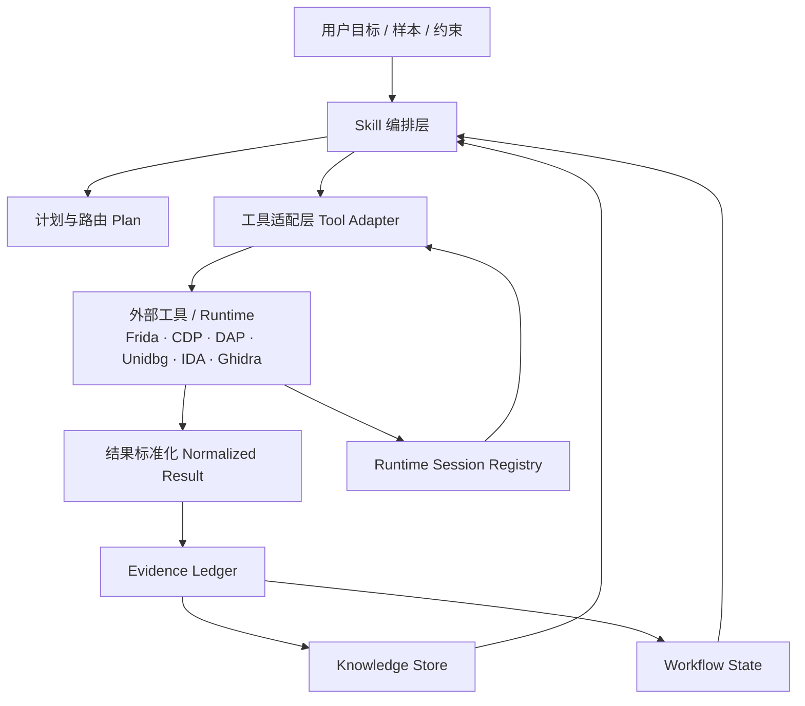
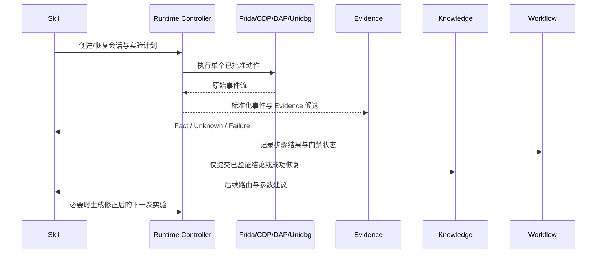

# rea 逆向 Agent 总体架构

## 目标

rea 的核心交付物是**可编排的逆向 Skill 系统**，不是工具数量集合。Skill 负责判断、路由、解释和推进；工具负责一次受控执行；领域状态负责保存可复现事实、运行时会话、知识和工作流。

测试采用分层契约验证和少量端到端冒烟。新增 Skill 或工具不再默认要求一套独立测试；只有改变共享契约、持久化、审批边界或关键用户路径时才增加回归覆盖。

## 总体分层



### 1. Skill 编排层

Skill 是模型可读的逆向方法论和决策约束，位于 `.agents/skills/` 或内置 Skill 资源中。它描述：

- 目标识别和 G0-G4 阶段
- 平台/格式路由
- 工具优先级、降级链和缺依赖处理
- 静态、动态、证据和复核的推进条件
- 何时暂停并要求用户批准
- 结果如何写入 Evidence、Knowledge 和 Workflow
- 如何控制上下文预算和输出粒度

Skill 不直接维护持久化状态，不实现解析器，不拼接任意 shell 命令，不把工具输出当作已验证结论。

推荐 Skill 族：

| Skill | 职责 |
|---|---|
| `reverse-lab` | 总体编排、阶段推进、失败恢复、证据纪律 |
| `native-binary-reverse` | PE/ELF/Mach-O、反调试、符号和 native 调试 |
| `android-reverse` | APK/AAB/DEX、脱壳、Frida、Unidbg、JNI/native 链路 |
| `web-protocol-reverse` | 浏览器/CDP、JS、网络、Crypto、WebSocket、GraphQL |
| `reverse-tool-guide` | 工具能力、依赖、安装、降级和调用示例 |
| `reverse-knowledge` | 检索、验证、沉淀和过期治理 |

### 2. 工具适配层

工具执行单个明确动作，不负责完整调查流程。每个工具必须声明：

```ts
interface ToolCapability {
  name: string;
  domain: "inspect" | "runtime" | "evidence" | "workflow" | "knowledge";
  approval: "read" | "write" | "exec";
  inputs: InputSchema;
  outputs: ResultSchema;
  dependencies: DependencySpec[];
  bounded: { maxBytes?: number; maxEvents?: number; timeoutMs?: number };
  artifacts: ArtifactPolicy;
}
```

工具结果统一为：

```ts
interface NormalizedToolResult<T> {
  ok: boolean;
  data?: T;
  facts?: FactCandidate[];
  artifacts?: ArtifactRef[];
  warnings?: string[];
  missingDependencies?: DependencyStatus[];
  error?: { category: string; message: string; retryable: boolean };
  locator?: string;
}
```

工具可以是纯解析器、外部 CLI 包装器、MCP 服务客户端或有生命周期的 Runtime Controller。它们都必须限制输入、输出、超时、事件数量和敏感信息。

### 3. 领域状态层

领域状态是被动、可持久化、可审计的事实源：

- **Workspace**：目标、项目根目录、样本摘要、产物和报告索引。
- **Evidence Ledger**：Fact、Hypothesis、Unknown、Conclusion；保存来源、定位、哈希、时间和验证关系。
- **Runtime Session**：Frida、Browser/CDP、DAP、Unidbg 等会话状态、心跳、恢复计划和事件缓冲。
- **Workflow State**：目标格式、步骤、门禁、状态、失败分类、重试和恢复计划。
- **Knowledge Store**：仅从验证后的结论或成功恢复路径沉淀可复用模式。

状态层不替代 Skill 决策；它提供可查询的状态和审计轨迹。

## 统一动态闭环



统一事件：

```ts
interface UniversalDynamicEvent {
  id: string;
  source: "frida" | "browser" | "dap" | "unidbg" | "custom";
  sessionId: string;
  seq: number;
  timestamp: string;
  kind: "message" | "stdout" | "stderr" | "trace" | "breakpoint" | "memory" | "network" | "crypto" | "lifecycle" | "error" | "custom";
  channel?: string;
  target?: string;
  payload?: unknown;
  raw?: string;
  metadata?: Record<string, unknown>;
}
```

事件只能先成为 Fact candidate；Hypothesis 验证成功后才能成为 Conclusion；Conclusion 才能触发 Knowledge promotion 和 Workflow advancement。

## Skill、工具和状态的边界

| 问题 | Skill | Tool | Domain state |
|---|---:|---:|---:|
| 目标属于 APK 还是 ELF | 决策和解释 | 提供识别结果 | 保存事实 |
| 选择 JADX、Frida 还是 Unidbg | 路由 | 声明能力和依赖 | 保存工作流计划 |
| 解析 ELF/DEX/APK | 不实现 | 执行解析 | 保存 Fact |
| 注入、断点、模拟执行 | 决策和审批请求 | 执行单步动作 | 保存 Session/Event |
| 失败后是否重试 | 归因和策略 | 返回可分类错误 | 保存 Recovery |
| 是否可沉淀知识 | 判断验证条件 | 提供证据引用 | 执行持久化 |

## Android 目标链

```text
APK/AAB
  -> package inspection
  -> DEX/Manifest/ABI/native .so inventory
  -> static route: JADX / Apktool / DEX / ELF
  -> dynamic route: ADB + Frida
  -> native route: JNI/RegisterNatives mapping
  -> emulation route: Unidbg ARM32/ARM64 + JNI call
  -> dump/decrypt/repair
  -> Evidence verification
  -> reusable Knowledge pattern
```

Unidbg 是 Runtime Controller，不是 Skill。Skill 只决定何时使用、需要哪些参数和验证标准。无法满足模拟环境时返回缺失依赖或环境缺口，不伪造调用结果。

## Browser 目标链

```text
Tab/CDP
  -> page/script/source map inventory
  -> hook preset selection
  -> network/WS/crypto/console capture
  -> Debugger breakpoint/stack/scope
  -> request or function replay
  -> structured event normalization
  -> Evidence correlation: script ↔ hook ↔ request ↔ result
  -> Knowledge/Workflow update
```

Browser Controller 负责 Tab、CDP 和事件生命周期；Browser Skill 负责逆向策略和风险判断。

## 基础工具 vs 可选工具策略与能力闭环 (Base vs Optional Tool Policy)

### 1. 工具分层策略

rea 坚持**Skill 为先、工具按需接入**的架构，反对盲目泛化堆砌外部工具：

- **基础工具 (Native Base Tools)**：内置于 rea 运行时的零依赖只读检验器与操作系统通用工具（如 `android_package_inspect`, `websocket_observe`, `windows_observe`, `pcap_inspect`, `sqlite_inspect`, `firmware_inspect`, `crashdump_inspect`, `binary_metadata_inspect`, `evm_inspect`, `binary_diff`, `r2_inspect`, `sourcemap_inspect`, `strings`, `file` 等）。这些工具**开箱即用、免安装、零配置**，保证任何环境下基本静态分类、结构解析与证据提取正常推进。
- **可选外部工具 (Optional Tools)**：特定深层逆向分析所需的高级 CLI 工具与 MCP 辅助服务（如 `apktool`, `jadx`, `unidbg`, `radare2`, `frida`, `mitmproxy`, `tshark`, `hbctool`, `playwright-mcp`, `r2mcp` 等）。它们在受信目录（`SKILL_TOOL_CATALOG` / `MCP_SERVICE_CATALOG`）中注册，**绝不要求在全新安装时一次性全部安装，也绝不允许静默自动安装**。

### 2. 场景能力模型 (Capability-Oriented Discovery)

Agent 面向分析**场景与能力**（Capability），而非单纯记忆零散工具名。系统在 `packages/coding-agent/src/extensibility/skill-tool-catalog.ts` 中维护规范能力描述器（`CapabilityDescriptor`）与实时解析器（`resolveReverseCapabilities`）：

| 能力标识 (`id`) | 场景说明 | 推荐原生工具 | 可选外部工具 | 降级链 (Fallbacks) | 受信安装命令 | 安装后即时调度 |
|---|---|---|---|---|---|---|
| `android_native_emulation` | ARM32/ARM64 Android .so 原生库无设备模拟执行与 JNI 调用 | `android_package_inspect` | `unidbg` | `frida`, `readelf`, `radare2` | `rea setup reverse unidbg` | 编写 Maven Java 测试用例或 McpToolkit 运行原生库仿真 |
| `apk_unpacking` | APK/AAB 资源解码、Manifest 解析与 Dalvik 字节码反编译 | `android_package_inspect` | `apktool`, `jadx`, `baksmali`, `dexdump` | `file`, `strings` | `rea setup reverse apktool` | 执行 `apktool d -f -o <dir> <apk>` 或 `jadx -d <dir> <apk>` |
| `browser_debugger` | 网页应用 DOM 调试、JS 动态断点、执行流分析与 CDP 自动化 | `browser_reverse_session` | `playwright-mcp` | `mitmproxy`, `curl`, `file` | `rea setup reverse playwright-mcp` | 配置 .rva/mcp.json playwright 服务或建立 CDP 调试会话 |
| `websocket_capture` | WebSocket 全双工数据帧实时截获、协议解包与序列分析 | `websocket_observe` | `mitmproxy`, `tshark` | `pcap_inspect`, `strings`, `curl` | `rea setup reverse mitmproxy` | 启动 `mitmweb --web-port 8081` 或 `tshark -Y websocket` |
| `native_debugger` | Native (ELF/PE/Mach-O) 二进制动态调试、内存与寄存器单步追踪 | `r2_inspect` | `radare2`, `r2mcp`, `frida`, `ghidra` | `binary_metadata_inspect`, `readelf`, `strings`, `file` | `rea setup reverse radare2` | 启动 `r2 -d <binary>` 或附加 Frida 会话 |
| `js_deobfuscation` | Minified/Packed JS 语法树解构、SourceMap 还原与 Hermes 字节码反汇编 | `sourcemap_inspect` | `hbctool` | `strings`, `file` | `rea setup reverse hbctool` | 执行 `hbctool disasm <bundle> <out>` 或脚本解混淆 |
| `traffic_interception` | HTTP/HTTPS 与网络协议透明代理、解密与重放 | `pcap_inspect` | `mitmproxy`, `tshark` | `curl`, `strings` | `rea setup reverse mitmproxy` | 启动 `mitmproxy -p 8080` 代理捕获 |

### 3. 用户面向的 Discover-before-stop / Install-then-dispatch 闭环流程

当逆向分析深入并需要特定外部高级能力时，Agent 严格执行以下五步连贯工作流，杜绝直接报错或卡死：

1. **Discover (能力发现，优先于终止)**：
   - Agent 调用 `rva setup reverse --json` 获取结构化能力状态 `capabilities[]` 与工具状态 `tools[]`。
   - 检查目标能力是否 `ready`；若未就绪，检查推荐原生工具或 `availableFallbacks` 是否足以满足当前阶段。
2. **Explain (清晰说明意图与先决条件)**：
   - 若分析确需外部高级工具介入，Agent 向用户客观陈述：
     - **能力目标** (Capability)：当前正在解决的问题（如“需要模拟执行 libencrypt.so 的 JNI 导出函数”）。
     - **为何需要** (Why)：原生工具或静态检查无法解开动态加密/环境绑定的原因。
     - **先决条件** (Prerequisites)：如 Java JDK、Node.js 等基础运行时。
     - **安全安装引导**：向用户展示受信命令（如 `rea setup reverse unidbg`）。
3. **Interactive Confirmation (用户显式审核确认)**：
   - 安装命令只能来自于受信 Catalog；Agent 绝不通过 arbitrary shell 偷偷执行下载。
   - 用户在 CLI 或交互式 TUI 设置面板中查看命令明细、包管理器来源及风险提示，输入 `[y/N]` 显式授权。
4. **Install-then-dispatch (安装完成即时调度)**：
   - 安装成功并刷新检测后，Agent **立即无缝衔接调度该工具**（执行 `postInstallInvocation` 所对应的操作），推进下一步分析，不强制用户重新输入目标或重开会话。
5. **Graceful Fallback (优雅降级保障)**：
   - 若用户选择暂不安装或当前环境无包管理器，Agent 绝不中断退出，而是回退到声明的降级工具链（如用 `readelf` 静态提取符号表 + `strings` 筛选关键词），继续记录 Fact 并标注未知项 (Unknown)。

## 审批与自动化边界

- 静态读取、哈希、格式识别：可自动执行。
- 写入项目产物、生成 dump、修改 Hook 或工作区：需要 write approval。
- 进程启动、附加、注入、网络代理、模拟执行：需要 exec approval。
- Skill 可以自动推进低风险步骤；动态步骤必须在能力、目标和批准状态明确时执行。
- 所有外部命令来自受信任目录或显式工具适配器，禁止 Skill 拼接任意 shell。

## 测试策略

### 必须验证的共享契约

- 工具注册、能力声明和审批等级
- 统一动态事件标准化和脱敏
- Evidence 引用、验证和持久化
- Knowledge 仅由 verified conclusion 晋升
- Workflow 门禁、恢复和状态迁移
- setup catalog 的依赖检测和安全命令

### 不要求逐项测试的内容

- 纯说明性 Skill 文案
- 已有契约不变的参考资料增补
- 仅增加一个已有工具的路由示例
- 不改变执行路径的知识条目

### 验证层级

1. 静态检查：导出、Schema、Skill frontmatter、工具注册。
2. 契约冒烟：统一事件 → Evidence → Knowledge → Workflow。
3. 关键路径冒烟：APK/native、Browser、Frida/DAP 各一条。
4. 外部工具真实验证：仅在依赖安装且用户提供样本时执行。

## 许可证边界

参考项目的公开接口、能力描述和行为可作为设计输入。代码和知识资产按许可证分别处理：

- MIT/Apache-2.0：按许可证保留声明后复用。
- GPL/AGPL 或来源不清：不直接复制到 rea 分发物。
- 受限知识库：使用自编、可追溯、可再分发的经验条目重写。

每次引入第三方实现必须同时记录来源、许可证、版本、修改方式和 NOTICE 需求。

## 后续实现顺序

1. 将现有工具结果逐步收敛到 `NormalizedToolResult`。
2. 将 Frida/CDP/DAP/Unidbg Controller 统一到 Runtime Session 接口。
3. 完善 Android JNI/Unidbg 实验模板和 Browser Debugger Controller。
4. 将失败归因、恢复和重试策略移回 Skill/Workflow 服务，工具保持单动作。
5. 建立少量跨层契约冒烟，删除重复的工具级业务编排。
6. 扩充可再分发知识库，并为每条经验标记来源、置信度和验证状态。
